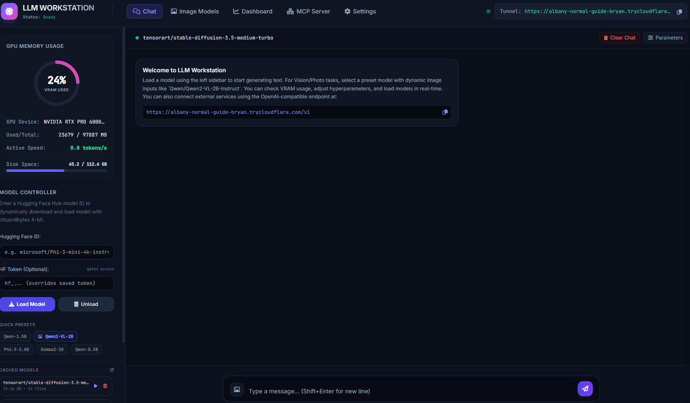
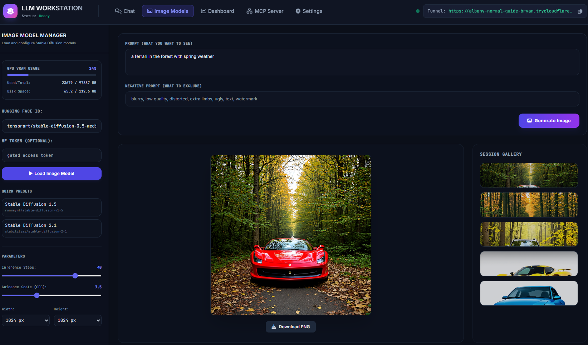

# LLM Workstation

Run Hugging Face and GGUF models on Google Colab, a GPU server or your own machine, with a chat UI, an OpenAI-compatible API, and tools from any MCP server. A Cloudflare tunnel gives you a public URL with one command.

| Chat & tools | Image generation |
| :---: | :---: |
|  |  |

## Quickstart

```bash
git clone https://github.com/haydarkadioglu/llm-workstation
pip install -r llm-workstation/requirements.txt
python llm-workstation/app.py
```

In a Colab cell, put `!` in front of each command. The server starts on port 8000, opens a tunnel and loads `Qwen/Qwen2.5-1.5B-Instruct`. The public URL is printed in the console and shown in the app.

### GGUF on a GPU

The default `llama-cpp-python` build runs on the CPU. For GPU layers, rebuild it with CUDA before starting:

```bash
CMAKE_ARGS="-DGGML_CUDA=on" pip install --force-reinstall --no-cache-dir llama-cpp-python
```

## Options

| Argument | Default | Description |
|---|---|---|
| `--host` | `0.0.0.0` | Address to bind. |
| `--port` | `8000` | Port to serve on. |
| `--model` | `Qwen/Qwen2.5-1.5B-Instruct` | Model to load at startup: a repo id, `org/repo/file.gguf`, or a local path. |
| `--no-model` | | Start without loading a model. |
| `--no-tunnel` | | Do not open a Cloudflare tunnel. |
| `--mcp-stdio` | | Serve MCP over stdio instead of HTTP. |

Settings, saved MCP servers and chats live in `~/.llm-workstation`. Set `LLM_WORKSTATION_HOME` to move them.

## Models

- **GGUF** models run through llama.cpp and **Transformers** models load in 4-bit on a GPU. Each uses the chat template shipped with the model.
- The context size is picked from the model and free VRAM. It can be set per model in the Chat models tab, along with GPU layers, and is remembered.
- Chat models load in **Chat models**, image models in **Image** and video models in **Video**. One model runs at a time, so loading one replaces the current one.
- When a conversation outgrows the context, the oldest turns are left out and the app says so.
- Stop really stops generation on the server, and so does closing the page.
- Split GGUF files download and load as one model.

## Using tools from an MCP server

Open the **MCP** tab and add the server. For a remote one, give it a URL and any headers it needs:

```
URL:     https://example.com/mcp
Headers: Authorization: Bearer YOUR_TOKEN
```

Then turn on **Tools** in the chat. The model calls tools by itself, sees each result, and can chain several calls before answering.

- Transports: Streamable HTTP and SSE (Auto tries them in that order), plus local stdio commands.
- Connections are watched and reconnect on their own, and saved servers come back on the next start. Saved headers are stored unencrypted in `mcp.json`.
- Each tool can be switched off, or run by hand with **Test**.
- Tools appear to the model as `server__tool`, so two servers can share a tool name.
- While tools are on, temperature is capped at 0.2 and the repeat penalty is off, because tool calls are much less reliable otherwise.
- One call runs per step. Models that batch calls tend to invent the arguments of the later ones, so the model is told to make those next, with real values.

### Choosing a model for tools

Tool use depends on the model. Use one trained for function calling, such as official Qwen 2.5, Llama 3.1+ or Mistral releases. Fine-tunes and very small models often invent results or describe a call instead of making it. The status tooltip shows whether a model has native tool support; those without it use a prompt-based fallback, which is weaker.

Recognised call formats are Hermes/Qwen `<tool_call>`, Mistral `[TOOL_CALLS]`, Llama `<|python_tag|>` and plain JSON. Other formats, such as the Pythonic calls of LFM models, are not parsed yet.

## Long tasks

The **Tasks** tab runs work in the background. Describe the goal and start it; the model keeps working when the page or the chat is closed. Tasks run one at a time, and everything from web search to MCP tools is available to them.

- **Task memory.** The model writes a plan and notes with its own tools. They are put back in front of it on every step, so the goal and what it has learned survive when old messages are trimmed from the context.
- **Save and continue.** Every step is saved. A task that is stopped, fails, hits its step limit or is cut off by a restart can continue from the same point with **Continue**.
- If the model stops with plan steps still open, it is told to keep going, up to three times.

Colab runtimes are wiped when they end, so keep task data on Drive if you want to continue there later:

```bash
LLM_WORKSTATION_HOME=/content/drive/MyDrive/LLM-Workstation/home python app.py
```

Nothing checks whether a task's result is correct, and small models can wander off the goal. Read the activity log, and start with a low step limit on a new model.

## Skills

A skill is a set of instructions the model follows in chats and tasks while it is switched on.

1. In the **Skills** tab, describe what you want.
2. The model writes a draft. Edit it by hand, or ask for changes.
3. Save it, and tick it on or off whenever you like.

Skills are plain Markdown files with a small header, stored in `~/.llm-workstation/skills`:

```markdown
---
name: weekly-report
description: Writes a weekly report.
---

1. List the wins, the risks and the next steps.
2. Stay under 150 words.
```

Use **Download** for one skill or **Download all** for a zip, and **Load from file** on any later run to bring back `.md` or `.zip` files. A skill only gives the model instructions, it does not run code. Every enabled skill takes up context, so switch off the ones you are not using.

## Using this workstation from elsewhere

**OpenAI API**: `POST /v1/chat/completions` and `GET /v1/models`, with streaming and `tools`. Tool calls are returned to the client, as with OpenAI.

```python
from openai import OpenAI

client = OpenAI(base_url="https://YOUR-SUBDOMAIN.trycloudflare.com/v1", api_key="unused")
response = client.chat.completions.create(
    model="local",
    messages=[{"role": "user", "content": "Hello"}],
)
```

**MCP server**: this app is also an MCP server at `/mcp` (Streamable HTTP), with `generate`, `load_model`, `unload_model` and `get_telemetry`.

There is no authentication: anyone who has the tunnel URL can use the app, including adding MCP servers that run commands. Use `--no-tunnel` on untrusted networks.

## Development

```bash
pip install pytest
python -m pytest tests
```

```
app.py              entry point
workstation/
  engine/           model loading and generation (GGUF, Transformers, diffusers)
  agent/            tool loop, tool call parsing, context fitting
  tasks/            background tasks, plan and notes, save and continue
  skills/           skill files and drafting
  mcp/              MCP client, server registry, this app's MCP server
  hub/              Hugging Face cache, downloads, Google Drive
  api/              HTTP routes
ui/                 static web UI, no build step
tests/
```
